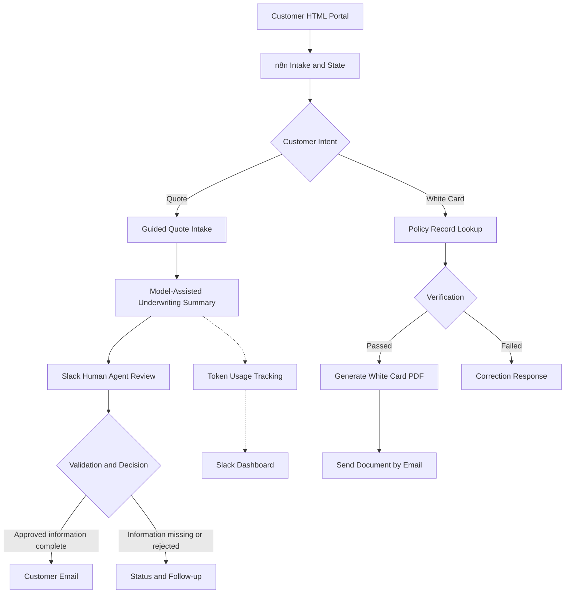

# AI-Assisted Insurance Automation — n8n Case Study

**Leonard Boykins | AI automation & workflow design portfolio**

**Status: Functional prototype; GDPR compliance review in progress. Not production-certified.**

This case study describes an AI-assisted insurance customer service prototype with a web portal, four n8n workflows, human review in Slack, email delivery, and AI token tracking. The source was reviewed as a design case study, not as evidence of a production-ready or compliant service.

> **Public showcase only.** These pages do not provide live workflow exports, policy databases, real customer records, insurer document assets, or executable integrations. The live project is maintained separately in a private repository.

## Business problem
Quote requests and requests for proof-of-insurance (“white cards”) involve collecting details, checking records, coordinating agent review, and communicating outcomes. The system explores structured automation for these steps without allowing an LLM to independently approve insurance coverage.

## Four workflow components

| Component | Function |
|---|---|
| NEW INSURANCE WORKFLOW | Customer intake, consent prompt, intent routing, state persistence, guided quote questions, underwriting summary and subworkflow calls |
| White Card Sub Workflow | Policy-number / birth-date intake, policy-table lookup, document generation and email delivery |
| Insurance Quote Async Review | Duplicate-post prevention, Slack review request, agent input, validation and customer communications |
| TOKEN TRACKING SUB | Captures available model usage, stores counts and posts an estimated usage dashboard to Slack |

## Architecture

## Design decisions
- **Human-in-the-loop:** A human insurance agent enters and reviews the quoted rate. The AI summary is not a binding underwriting or coverage decision.
- **Structured validation:** Guided choices and field validation reduce ambiguous input.
- **State and duplicate protection:** Data-table-backed conversations and quote-thread tracking support asynchronous review.
- **Cost awareness:** Token tracking aims to measure model usage; execution allowances shown in dashboards are estimates, not billing records.
- **Separation of duties:** Intake, document issuing, quote review and usage logging are distinct workflows.

## Skills demonstrated
n8n orchestration; JavaScript Code nodes; APIs and webhooks; HTML/CSS/JavaScript portal; structured customer intake; data tables; Slack review flows; Gmail notifications; generated PDFs; model integration; operational monitoring.

## Limitations and current maturity
No public claim is made that this system is production-safe, GDPR-compliant, legally approved for insurance business, security-certified, or end-to-end tested. Details such as rights handling, retention, provider contractual agreements, access control, authorization, and independent security evaluation need review before production deployment.

See [GDPR-readiness roadmap](GDPR-READINESS.md), [security approach](SECURITY.md), and [workflow structure](WORKFLOW-STRUCTURE.md).

## Discussion / portfolio focus
This project illustrates the judgment to decide **what needs AI and what is better handled with deterministic automation**, as well as the ability to design auditable human handoffs. Demonstrations should use synthetic data only.
